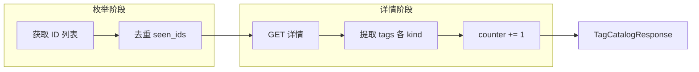

# 全量爬取策略（`djm catalog`）

> 对应 ticket：[全量爬取遍历与限速策略](../.wayfinder/tickets/005-grilling-full-crawl-strategy.md)

`catalog` 命令：枚举本子 ID → 拉详情 → **内存**聚合 `(kind, name) → count` → 输出 `TagCatalogResponse` JSON。不写数据库。

---

## 总览



两站共性：**列表接口不含完整 tags**，必须 **N+1 详情请求**。限速以详情阶段为主。

---

## 哔咔（bika）

### 主路径：分类分页

| 步骤 | API | 说明 |
|------|-----|------|
| 1 | `GET /categories` | 获取全部分区 `title` |
| 2 | `GET /comics?c={title}&page={n}&s=dd` | 每分类按「新→旧」分页，直到 `page > pages` |
| 3 | 收集 `docs[*]._id` | 全局 `seen_ids` 去重 |
| 4 | `GET /comics/{id}` | 逐本取 `tags` / `author`（`categories` 不入词表） |

**排序 `s=dd`**：优先抓新本；全量需扫完所有页。

### 不采用为主路径

| 路径 | 原因 |
|------|------|
| 排行榜 `leaderboard` | 无分页，仅热门子集 |
| `/keywords` | 搜索热词，非 tag 目录 |
| 高级搜索 | 需关键词，无法完备枚举 |

### 限速与重试

| 参数 | 建议值 | 依据 |
|------|--------|------|
| 列表请求间隔 | 0.5–1 s | 社区低 QPS |
| 详情请求间隔 | **1–2 s**（默认 **1.5 s**） | pica_crawler `interval_time=5` 偏保守；tag-only 可略快 |
| 并发 | **1**（串行） | 单账号、防 429 |
| 超时 | 15 s | |
| 重试 | 最多 3 次，指数退避 2/4/8 s | 429/5xx |
| 代理 | 默认直连；国内失败时用 `djm config set proxy` 或 `--proxy` | 见 [`credentials.md`](credentials.md) |
| 认证 | login token + 签名头 | 401 时重登 |

### 体量估算

- 假设全站 ~10⁵ 本子量级（随时间增长）
- 详情 1.5 s/本 → **~40+ 小时** 量级（可 `--checkpoint` 分多次跑）
- 单次 catalog 建议用户心理预期：**数小时至一天**，非实时

---

## 禁漫（jmcomic）

### 主路径：`categories_filter_gen`

```python
for page in client.categories_filter_gen(
    page=1,
    category=JmMagicConstants.CATEGORY_ALL,  # 再叠加其他 category 可选
    time=JmMagicConstants.TIME_ALL,
    order_by=JmMagicConstants.ORDER_BY_LATEST,
):
    for album_id, title in page:
        ...
```

**扩展覆盖（v1 默认开启）**：对以下 `category` 各跑一遍 gen，合并 `seen_ids`（同一本可能重复出现，去重后详情只拉一次）：

- `CATEGORY_ALL`
- `CATEGORY_DOUJIN`, `CATEGORY_SINGLE`, `CATEGORY_SHORT`, `CATEGORY_HANMAN`, `CATEGORY_MEIMAN`, `CATEGORY_3D`

`time=TIME_ALL` + `order_by=ORDER_BY_LATEST` 为主；不穷举所有 `time × order_by` 组合（收益递减、耗时长）。

### 客户端

| 项 | 决定 |
|----|------|
| 实现 | **`api`（JmApiClient）** | IP 兼容性好 |
| 代理 | 默认直连；403/失败时再手动配置 | 见 [`credentials.md`](credentials.md) |
| 缓存 | `cache: level_option` | 避免重复详情 |
| `retry_times` | 5（库默认） | |

### 不采用为主路径

| 路径 | 原因 |
|------|------|
| `search_tag` | 需已知 tag 名，不能发现新 tag |
| 日/周/月榜 | 仅热门子集 |

### 限速与重试

| 参数 | 建议值 |
|------|--------|
| 详情间隔 | **0.3–0.5 s**（默认 **0.4 s**） |
| 并发 | **1** |
| 枚举页 | 依赖库内翻页，页间无额外 sleep（库已控制） |

### 体量估算

- 全站体量与哔咔同级或更大
- 0.4 s/本 → **十小时级** 以上；务必支持 checkpoint

---

## 内存聚合

```python
from collections import Counter

# key: (kind, name)  value: count
tag_counter: Counter[tuple[str, str]] = Counter()

def absorb(comic_tags: list[tuple[str, str]]) -> None:
    tag_counter.update(comic_tags)

# 输出前排序：count 降序，同 count 按 name
tags_out = [
    {"kind": k, "name": n, "count": c}
    for (k, n), c in tag_counter.most_common()
]
```

**内存**：假设 5×10⁴ 唯一 tag × ~50 字节 ≈ 几 MB，可忽略。`seen_ids` set 约 10⁵ × 24B ≈ 几 MB。

---

## `--checkpoint` 格式（可选续爬）

非 tag 库，仅进度文件。JSON：

```json
{
  "schema_version": "1.0",
  "source": "bika",
  "started_at": "2026-08-30T05:00:00Z",
  "updated_at": "2026-08-30T06:30:00Z",
  "phase": "detail",
  "enum": {
    "categories_done": ["同人", "短篇"],
    "current_category": "全彩",
    "current_page": 42
  },
  "seen_ids": ["id1", "id2"],
  "pending_ids": ["id3", "id4"],
  "detail_done_ids": ["id1"],
  "tag_counter": {
    "tag:巨乳": 1523,
    "category:同人": 890
  },
  "stats": {
    "albums_scanned": 5000,
    "errors": 2
  }
}
```

| 字段 | 说明 |
|------|------|
| `phase` | `enum`（仍在枚举 ID）\| `detail`（枚举完成，扫详情） |
| `enum.*` | 枚举断点（哔咔：分类+页；禁漫：category 索引+页） |
| `seen_ids` | 已见 ID（枚举阶段增长） |
| `pending_ids` | 枚举完成后待拉详情的 ID 队列（可选，或 detail 阶段从 seen 减 done 推导） |
| `detail_done_ids` | 已处理详情（可改为只存 done 以省空间，大站用 **Bloom / 分片文件** 留 v2） |
| `tag_counter` | 键 `"kind:name"`，续跑时加载 |

**写入频率**：每处理 **50** 本详情或每 **60 s** 刷盘一次（先到先写）。

**CLI**：

```bash
djm catalog --source bika --checkpoint progress.json
djm catalog --source bika --checkpoint progress.json --resume
```

---

## `fetch` 批量（功能 2）限速

与 catalog 详情阶段相同间隔，串行：

```bash
djm fetch --source jmcomic --ids id1,id2,id3
# 默认间隔 --delay 0.4（禁漫）/ 1.5（哔咔），可覆盖
```

失败项写入 response `errors[]`，不中断其余 ID。

---

## 默认 CLI 参数汇总

| 参数 | bika 默认 | jmcomic 默认 |
|------|-----------|--------------|
| `--delay` | 1.5 | 0.4 |
| `--retries` | 3 | 3 |
| `--timeout` | 15 | 15 |
| `--checkpoint` | 可选 | 可选 |

---

## 实现检查清单

- [ ] 枚举器：`BikaCategoryEnumerator` / `JmCategoryEnumerator`
- [ ] 详情提取：`extract_tags_bika(comic)` / `extract_tags_jmcomic(album)` → `list[(kind,name)]`
- [ ] 聚合器：`TagCounter` 包装 Counter + checkpoint 序列化
- [ ] 限速：`asyncio.sleep` 或 `time.sleep(delay)` 于每次详情前
- [ ] 进度：stderr 人类可读日志；stdout **仅最终 JSON**（或 `--verbose` 分离）
