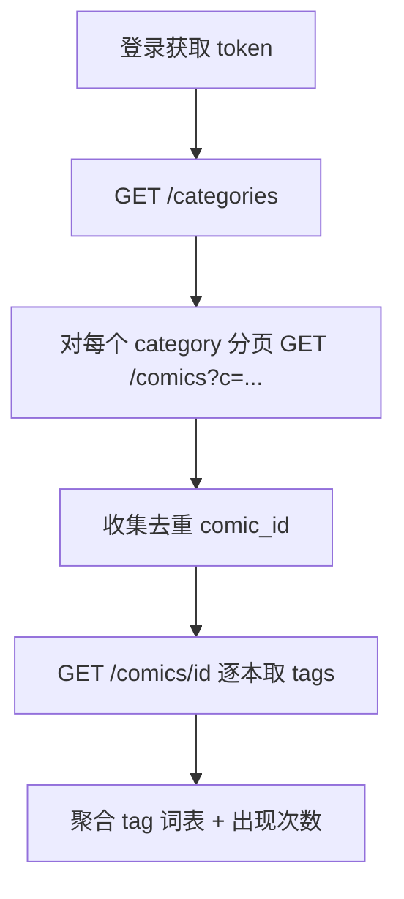

# 哔咔漫画（PicaComic）非官方 API — Tag 爬取调研

> 调研日期：2026-08-30  
> 目标：评估非官方移动端 API 对「单本 tag 提取」与「全站 tag 词表构建」的可行性。  
> **说明**：哔咔无公开官方 API 文档；本文结论均来自开源客户端源码与逆向分析文章。未找到可稳定访问的 Apifox 公开共享文档（见文末）。

---

## 0. 基础信息

| 项 | 值 | 来源 |
|---|---|---|
| API Base URL | `https://picaapi.picacomic.com/` | [pica_crawler/client.py](https://github.com/lx1169732264/pica_crawler/blob/master/src/client.py)、[PicaComicClient.kt](https://github.com/czp3009/picacomic-api/blob/master/src/main/kotlin/com/hiczp/picacomic/api/PicaComicClient.kt) |
| 响应格式 | JSON，`Content-Type: application/vnd.picacomic.com.v1+json` | [PicaHeader.java](https://github.com/2024baibai/PicaComic-Api/blob/master/src/com/flannep/picacomic/api/PicaHeader.java) |
| 通用响应壳 | `{ "code": 200, "message": "success", "data": { ... } }` | [Response.kt](https://github.com/czp3009/picacomic-api/blob/master/src/main/kotlin/com/hiczp/picacomic/api/service/Response.kt)、[README.MD](https://github.com/2024baibai/PicaComic-Api/blob/master/README.MD) |

---

## 1. 单本 tag：按 ID 获取

### 1.1 端点

```
GET /comics/{comic_id}
```

- 完整 URL 示例：`https://picaapi.picacomic.com/comics/{comic_id}`
- 实现参考：[PicaBookApi.getBookDetail](https://github.com/2024baibai/PicaComic-Api/blob/master/src/com/flannep/picacomic/api/book/PicaBookApi.java)、[picaapi.py comics()](https://github.com/yindaheng98/picacomic/blob/master/picaapi.py)、[pica_crawler comic_info()](https://github.com/lx1169732264/pica_crawler/blob/master/src/client.py)

### 1.2 响应结构

成功时 `data` 内嵌 `comic` 对象（非直接平铺）：

```json
{
  "code": 200,
  "message": "success",
  "data": {
    "comic": { ... }
  }
}
```

### 1.3 Tag 与相关字段

| 字段 | 类型 | 说明 | 列表接口是否包含 |
|---|---|---|---|
| `tags` | `string[]` | **自由标签**（如「萌」「全彩」） | ❌ 仅详情 |
| `categories` | `string[]` | **平台分区**（如「同人」「短篇」） | ✅ 列表也有 |
| `_id` | `string` | 本子唯一 ID | ✅ |
| `title` | `string` | 标题 | ✅ |
| `author` | `string` | 作者 | ✅ |
| `chineseTeam` | `string` | 汉化组 | ❌ 仅详情 |
| `description` | `string` | 简介 | ❌ 仅详情 |
| `_creator` | `object` | 上传者信息 | ❌ 仅详情 |
| `created_at` / `updated_at` | ISO8601 | 创建/更新时间 | 详情完整；列表部分有 `updated_at` |
| `viewsCount` / `likesCount` / `commentsCount` | `number` | 浏览/点赞/评论数 | 详情 |

字段定义来源：[BookDetailInfo.java](https://github.com/2024baibai/PicaComic-Api/blob/master/src/com/flannep/picacomic/api/book/BookDetailInfo.java)、[BookSimpleInfo.java](https://github.com/2024baibai/PicaComic-Api/blob/master/src/com/flannep/picacomic/api/book/BookSimpleInfo.java)、[ComicDetail.kt](https://github.com/czp3009/picacomic-api/blob/master/src/main/kotlin/com/hiczp/picacomic/api/service/comic/model/ComicDetail.kt)

### 1.4 示例响应片段（tags）

来源：[README.MD — BookDetailInfo](https://github.com/2024baibai/PicaComic-Api/blob/master/README.MD)

```json
{
  "tags": ["萌", "全彩"],
  "categories": ["同人", "短篇", "純愛"],
  "chineseTeam": "meaqua贴贴制糖组",
  "author": "sadsadsadsads",
  "title": "[xx汉化组]xxxxxxxxxxxxxxxx"
}
```

### 1.5 关键结论

- **没有独立的 tag 查询端点**；`tags` 仅出现在本子详情中。
- 列表类接口（搜索、分类、收藏、排行榜）返回的 `Comic` / `BookSimpleInfo` **不含 `tags` 字段**，只有 `categories`。
- 本子 ID 即 URL 路径中的 `{comic_id}`（MongoDB ObjectId 字符串）；[pica_crawler README](https://github.com/lx1169732264/pica_crawler/blob/master/README.md) 说明 Web 详情页 `comic/` 后即为 ID。

---

## 2. 全站枚举：构建 tag 词表

### 2.1 不存在「列出全部本子」的单端点

社区客户端均通过 **分类分页 / 搜索分页 / 排行榜（有限集）** 组合覆盖。无 `/comics/all` 之类接口。

### 2.2 推荐枚举路径

#### A. 分类浏览（全量爬取主路径）

```
GET /categories
GET /comics?c={category_title}&page={page}&s={sort}
```

| 参数 | 含义 | 来源 |
|---|---|---|
| `c` | 分类名，取自 `/categories` 返回的 `title` | [ComicService.search](https://github.com/czp3009/picacomic-api/blob/master/src/main/kotlin/com/hiczp/picacomic/api/service/comic/ComicService.kt) |
| `page` | 页码，从 1 开始 | 同上、[PicaBookResult](https://github.com/2024baibai/PicaComic-Api/blob/master/src/com/flannep/picacomic/api/book/PicaBookResult.java) |
| `s` | 排序；`category` 生效时其他筛选无效 | [ComicService 注释](https://github.com/czp3009/picacomic-api/blob/master/src/main/kotlin/com/hiczp/picacomic/api/service/comic/ComicService.kt) |

**排序值 `s`（pica_crawler 实测命名）** — [client.py](https://github.com/lx1169732264/pica_crawler/blob/master/src/client.py)：

| 值 | 含义 |
|---|---|
| `ua` | 默认 |
| `dd` | 新→旧（适合抓最近更新） |
| `da` | 旧→新 |
| `ld` | 最多爱心 |
| `vd` | 最多指名 |

**分页响应**（键名 `comics` 或部分客户端直接返回分页对象）：

```json
{
  "docs": [ { "_id": "...", "title": "...", "categories": [...] } ],
  "total": 12345,
  "limit": 20,
  "page": 1,
  "pages": 618
}
```

结构来源：[PicaBookResult.java](https://github.com/2024baibai/PicaComic-Api/blob/master/src/com/flannep/picacomic/api/book/PicaBookResult.java)

**分类列表示例分区**（config 注释，需运行时 `/categories` 刷新）：全彩、長篇、同人、短篇、純愛、NTR 等 — [config_backup.ini](https://github.com/lx1169732264/pica_crawler/blob/master/config/config_backup.ini)

#### B. 关键词搜索

**旧式 GET 搜索**（2024baibai 实现）：

```
GET /comics/search?page={page}&q={keyword}
```

来源：[PicaBookApi.search](https://github.com/2024baibai/PicaComic-Api/blob/master/src/com/flannep/picacomic/api/book/PicaBookApi.java)

**新式 POST 高级搜索**（pica_crawler 订阅功能使用）：

```
POST /comics/advanced-search?page={page}
Content-Type: application/json

{"keyword": "关键词", "sort": "dd", "categories": []}
```

来源：[ComicService.advancedSearch](https://github.com/czp3009/picacomic-api/blob/master/src/main/kotlin/com/hiczp/picacomic/api/service/comic/ComicService.kt)、[AdvancedSearchRequest.kt](https://github.com/czp3009/picacomic-api/blob/master/src/main/kotlin/com/hiczp/picacomic/api/service/comic/model/AdvancedSearchRequest.kt)、[pica_crawler search()](https://github.com/lx1169732264/pica_crawler/blob/master/src/client.py)

**通用列表查询**（可按 tag/作者等筛选，但非 tag 词表 API）：

```
GET /comics?page={page}&t={tags}&a={author}&c={category}&s={sort}&f={finished}
```

来源：[ComicService.search](https://github.com/czp3009/picacomic-api/blob/master/src/main/kotlin/com/hiczp/picacomic/api/service/comic/ComicService.kt)、[pica_crawler comics()](https://github.com/lx1169732264/pica_crawler/blob/master/src/client.py)

#### C. 排行榜（覆盖有限，作增量补充）

```
GET /comics/leaderboard?tt={H24|D7|D30}&ct=VC
GET /comics/knight-leaderboard
GET /comics/random
```

| 参数 | 含义 |
|---|---|
| `tt` | `H24` 日榜 / `D7` 周榜 / `D30` 月榜 |
| `ct` | 分类过滤，常用 `VC` |

来源：[ComicService.getLeaderBoard](https://github.com/czp3009/picacomic-api/blob/master/src/main/kotlin/com/hiczp/picacomic/api/service/comic/ComicService.kt)、[pica_crawler leaderboard()](https://github.com/lx1169732264/pica_crawler/blob/master/src/client.py)

排行榜返回 **`data.comics` 数组**，**无分页**，仅热门子集，**不能**单独支撑全站 tag 词表。

#### D. 用户收藏（可选、非全站）

```
GET /users/favourite?page={page}&s={order}
```

来源：[PicaUserApi.getMyFavorite](https://github.com/2024baibai/PicaComic-Api/blob/master/src/com/flannep/picacomic/api/users/PicaUserApi.java)

#### E. 热词（非 tag 词表）

```
GET /keywords
```

返回搜索热词列表，**不是**全站 tag 目录 — [KeywordService.kt](https://github.com/czp3009/picacomic-api/blob/master/src/main/kotlin/com/hiczp/picacomic/api/service/keyword/KeywordService.kt)

### 2.3 全站 tag 词表构建流程（逻辑）



**注意**：列表阶段只能拿到 `categories`；**必须二次请求详情**才能拿到 `tags[]`。

### 2.4 覆盖率评估

| 策略 | 预期覆盖率 | 说明 |
|---|---|---|
| 全分类 × 全分页 | 高（接近全站） | 社区爬虫主流做法；分类变更需定期刷新 `/categories` |
| 排行榜 | 低 | 仅热门 TOP |
| 关键词搜索 | 取决于词表 | 无法保证完备 |
| `/keywords` | 不适用 | 热词 ≠ tag 目录 |

---

## 3. 认证：登录、Authorization、签名

### 3.1 登录

```
POST /auth/sign-in
Content-Type: application/json; charset=UTF-8

{"email": "账号", "password": "密码"}
```

响应：

```json
{
  "code": 200,
  "data": { "token": "<JWT-like string>" }
}
```

来源：[PicaLogin.java](https://github.com/2024baibai/PicaComic-Api/blob/master/src/com/flannep/picacomic/api/PicaLogin.java)、[AuthService.kt](https://github.com/czp3009/picacomic-api/blob/master/src/main/kotlin/com/hiczp/picacomic/api/service/auth/AuthService.kt)、[picaapi.py login()](https://github.com/yindaheng98/picacomic/blob/master/picaapi.py)

### 3.2 Authorization 头

- 头名：`authorization`（小写，**无** `Bearer` 前缀）
- 值：登录返回的 `data.token` 原样填入
- 有效期：约 **1–2 周**（README 描述，需过期重登） — [README.MD](https://github.com/2024baibai/PicaComic-Api/blob/master/README.MD)
- 登录、注册等 `/auth/*` 端点**不需要** authorization — [AuthService @NO_AUTH](https://github.com/czp3009/picacomic-api/blob/master/src/main/kotlin/com/hiczp/picacomic/api/service/auth/AuthService.kt)
- 未带 token 的业务请求通常返回 **401**

### 3.3 签名算法（当前社区通用简化版）

每次请求需动态计算 `signature`：

```
raw = path + timestamp + nonce + METHOD + api_key
signature = hex( HMAC-SHA256( key=secret_key, message=raw.lower() ) )
```

| 变量 | 说明 |
|---|---|
| `path` | 去掉 base URL 后的路径，**不含** leading `/`；含 query string。例：`comics/abc123` 或 `comics/advanced-search?page=1` |
| `timestamp` | Unix 秒，写入 header `time`（字符串） |
| `nonce` | 32 位十六进制随机串；header `nonce`。**每次请求应重新生成**（部分旧代码复用固定 nonce 仍能工作，但不建议） |
| `METHOD` | `GET` 或 `POST` |
| `api_key` | 固定 `C69BAF41DA5ABD1FFEDC6D2FEA56B` |
| `secret_key` | 见下表 |

实现参考：[picaapi.py __encrypt](https://github.com/yindaheng98/picacomic/blob/master/picaapi.py)、[pica_crawler http_do](https://github.com/lx1169732264/pica_crawler/blob/master/src/client.py)、[PicaComicClient.kt](https://github.com/czp3009/picacomic-api/blob/master/src/main/kotlin/com/hiczp/picacomic/api/PicaComicClient.kt)、[PicaComicInherent.kt](https://github.com/czp3009/picacomic-api/blob/master/src/main/kotlin/com/hiczp/picacomic/api/PicaComicInherent.kt)

### 3.4 secret_key 版本差异

| 版本 | secret_key | 来源 |
|---|---|---|
| **当前主流** | 以 `/*Cn` 结尾、**无**尾部反引号（长度 63；勿把 markdown 围栏算进密钥） | [PicaComicInherent.kt](https://github.com/czp3009/picacomic-api/blob/master/src/main/kotlin/com/hiczp/picacomic/api/PicaComicInherent.kt)、[pica-cli](https://github.com/justorez/pica-cli)、[pica-go client.go](https://github.com/niuhuan/pica-go/blob/master/client.go) |
| 旧版（2019 逆向） | `~n}$S9$lGts=U)8zfL/R.PM9;4[3|@/CEsl~Kk!7?BYZ:BAa5zkkRBL7r|1/*Cr` | [PicaHeader.java](https://github.com/2024baibai/PicaComic-Api/blob/master/src/com/flannep/picacomic/api/PicaHeader.java)、[接口分析手记](https://blog.kaaass.net/archives/1074) |

[pica_crawler](https://github.com/lx1169732264/pica_crawler/blob/master/config/config_backup.ini) 将 `pica_secret_key` 列为必填；错误密钥会导致登录响应无 `token` 或签名失败。历史密钥来源见 [知乎专栏（AnkiKong）](https://zhuanlan.zhihu.com/p/547321040)（链接可能失效，以活跃开源库为准）。

### 3.5 新版 App 签名（扩展）

较新 Android 客户端在 native 层拼接时还包含 `app-version`、`app-build-version` — [HonKit 模拟客户端](https://www.hiczp.com/wang-luo/mo-ni-bi-ka-android-ke-hu-duan.html)、[腾讯云开发者社区分析](https://cloud.tencent.com/developer/article/1934570)。**多数 Python/Go/Kotlin 开源库仍使用简化 5 段拼接且可用**；若遇 400 签名错误，再尝试扩展拼接。

### 3.6 时间戳规则

- 单位：**秒**
- 与服务器时差 **≤ 300 秒**，否则报时间戳过期 — [README.MD](https://github.com/2024baibai/PicaComic-Api/blob/master/README.MD)、[PicaHeader.java 注释](https://github.com/2024baibai/PicaComic-Api/blob/master/src/com/flannep/picacomic/api/PicaHeader.java)
- `time` header 必须与签名计算中的 timestamp **一致**

---

## 4. 速率限制、请求头、代理

### 4.1 必需 / 推荐请求头

| Header | 典型值 | 必需 | 来源 |
|---|---|---|---|
| `api-key` | `C69BAF41DA5ABD1FFEDC6D2FEA56B` | ✅ | [PicaComicInherent.kt](https://github.com/czp3009/picacomic-api/blob/master/src/main/kotlin/com/hiczp/picacomic/api/PicaComicInherent.kt) |
| `accept` | `application/vnd.picacomic.com.v1+json` | ✅ | 同上 |
| `app-channel` | `1` / `2` / `3`（分流） | ✅ | [config_backup.ini](https://github.com/lx1169732264/pica_crawler/blob/master/config/config_backup.ini) |
| `app-version` | 如 `2.2.1.2.3.3` | ✅ | 同上 |
| `app-build-version` | 如 `44`–`45` | ✅ | 同上 |
| `app-platform` | `android` | ✅ | 同上 |
| `app-uuid` | 如 `defaultUuid` | ✅ | 同上 |
| `User-Agent` | `okhttp/3.8.1` | ✅ | 同上 |
| `image-quality` | `original` | 推荐 | 同上 |
| `time` | Unix 秒 | ✅ | 签名 |
| `nonce` | 32 hex | ✅ | 签名 |
| `signature` | HMAC 结果 | ✅ | 签名 |
| `authorization` | 登录 token | 业务 API ✅ | [README.MD](https://github.com/2024baibai/PicaComic-Api/blob/master/README.MD) |
| `Content-Type` | `application/json; charset=UTF-8` | POST 必需 | [PicaLogin.java](https://github.com/2024baibai/PicaComic-Api/blob/master/src/com/flannep/picacomic/api/PicaLogin.java) |
| `Host` | 图片 CDN 如 `s3.picacomic.com` | 下图片时需要 | [README.MD — 获取图片](https://github.com/2024baibai/PicaComic-Api/blob/master/README.MD) |

**登录 POST 若缺少 `Content-Type` 可能返回 `too many requests`** — [PicaLogin.java 注释](https://github.com/2024baibai/PicaComic-Api/blob/master/src/com/flannep/picacomic/api/PicaLogin.java)

### 4.2 速率限制（非官方）

哔咔**未公开**正式 QPS 文档。社区经验：

| 实践 | 值 | 来源 |
|---|---|---|
| 全量爬取时每本间隔 | `interval_time = 5` 秒 | [config_backup.ini](https://github.com/lx1169732264/pica_crawler/blob/master/config/config_backup.ini) |
| 请求超时 | `request_time_out = 10` 秒 | 同上 |
| 失败重试 | sleep 10s 后重试 | [picaapi.py](https://github.com/yindaheng98/picacomic/blob/master/picaapi.py) |
| 图片并发 | 与 API 元数据请求分开；默认 5 线程 | [config_backup.ini](https://github.com/lx1169732264/pica_crawler/blob/master/config/config_backup.ini) |

**Tag 爬取建议**：元数据请求（列表 + 详情）保持 **1–2 req/s 以下**，详情批量阶段加 jitter；遇 429/5xx 指数退避。

### 4.3 代理与分流

| 场景 | 建议 | 来源 |
|---|---|---|
| 国内访问 API | **需要** HTTP/SOCKS 代理（科学上网） | [pica_crawler README](https://github.com/lx1169732264/pica_crawler/blob/master/README.md) |
| 配置方式 | `request_proxy` 如 `http://127.0.0.1:7890` | [config_backup.ini](https://github.com/lx1169732264/pica_crawler/blob/master/config/config_backup.ini) |
| API 分流故障 | 切换 `app-channel` 1/2/3 | [config_backup.ini 注释](https://github.com/lx1169732264/pica_crawler/blob/master/config/config_backup.ini) |
| 动态域名 | 部分 Java 客户端支持 `PicaDomainManager` | [JUKOMU README](https://github.com/JUKOMU/PicaComic-Api-Java/blob/master/README.md) |

本项目仅爬 tag 元数据，**无需**下载图片，可忽略 CDN `Host` 与图片代理逻辑。

---

## 5. 对本项目（Python、本地、全量 + 按需）的建议

### 5.1 架构建议

```
doujinshi_tag_geter/
  bika/
    client.py      # 签名 + 会话 + 重试
    catalog.py     # 分类分页枚举
    tags.py        # 详情 tag 提取
    store.py       # SQLite/JSON 持久化 comic_id + tags
```

### 5.2 实现要点

1. **客户端**：参考 [pica_crawler/client.py](https://github.com/lx1169732264/pica_crawler/blob/master/src/client.py)（Python、配置化、代理支持）或精简 [picaapi.py](https://github.com/yindaheng98/picacomic/blob/master/picaapi.py)。
2. **密钥与头**：使用 [PicaComicInherent.kt](https://github.com/czp3009/picacomic-api/blob/master/src/main/kotlin/com/hiczp/picacomic/api/PicaComicInherent.kt) 中的 `secret_key` + app 版本；`nonce` 每请求刷新。
3. **凭证**：账号密码放 `.env` / 本地配置，**勿入库**（见 [.wayfinder/tickets/003](../../.wayfinder/tickets/003-task-bika-account-proxy.md)）。
4. **Token 缓存**：本地文件缓存 token，401 时自动重登。

### 5.3 全量爬取（tag 词表）

```
1. login()
2. categories = GET /categories
3. for cat in categories:
     for page in 1..pages:
       ids += GET /comics?c={cat.title}&page={page}&s=dd → docs[*]._id
4. ids = dedupe(ids)
5. for id in ids:
     tags += GET /comics/{id} → data.comic.tags
6. 写入 DB：comic 记录 + tag 倒排索引 + tag 计数
```

- 持久化已处理 `comic_id`，支持断点续爬。
- 定期（如每周）按 `s=dd` 从各分类**前几页**增量更新新本子。
- `categories` 与 `tags` 分开存储：`categories` 是平台固定分区，`tags` 是自由标签。

### 5.4 按需爬取

```
GET /comics/{id}  → 提取 tags + categories + author + title
```

可选：用户输入关键词时走 `POST /comics/advanced-search` 获 ID 列表再拉详情。

### 5.5 不做 / 低优先级

- 排行榜、随机 → 仅作 spot check，不作全量来源。
- `/keywords` → 搜索热词，非 tag 目录。
- 图片 endpoints（`/eps`、`/pages`）→ tag 项目不需要。

### 5.6 风险

| 风险 | 缓解 |
|---|---|
| secret_key 或 app 版本变更 | 锁定依赖活跃开源库；签名失败时告警 |
| 账号封禁 / 429 | 低 QPS、单账号、可选多账号轮换 |
| 列表无 tags 导致 N+1 请求 | 本地缓存详情；增量更新 |
| 无官方 SLA | 爬取结果标注 `source=bika` + `crawled_at` |

---

## 6. Apifox 文档检索结果

多次检索 **未发现** 可公开访问、可索引的「哔咔 / PicaComic / picaapi」Apifox 共享项目（`apifox.com/apidoc/shared-*` 未命中相关 API）。

**替代 primary sources**（按推荐顺序）：

1. [2024baibai/PicaComic-Api](https://github.com/2024baibai/PicaComic-Api) — Java 参考实现 + README 字段说明  
2. [lx1169732264/pica_crawler](https://github.com/lx1169732264/pica_crawler) — Python 生产级爬虫（分类/搜索/排行榜/详情）  
3. [czp3009/picacomic-api](https://github.com/czp3009/picacomic-api) — Kotlin 端点最全（ComicService 等）  
4. [yindaheng98/picacomic/picaapi.py](https://github.com/yindaheng98/picacomic/blob/master/picaapi.py) — 最小 Python 签名实现  
5. [hiczp 模拟 Android 客户端](https://www.hiczp.com/wang-luo/mo-ni-bi-ka-android-ke-hu-duan.html) — 请求头与签名逆向  

---

## 7. 端点速查表

| 用途 | Method | Path | Tag 相关 |
|---|---|---|---|
| 登录 | POST | `/auth/sign-in` | — |
| 分类列表 | GET | `/categories` | 枚举入口 |
| 分类下本子 | GET | `/comics?c=&page=&s=` | 列表无 tags |
| 搜索（旧） | GET | `/comics/search?page=&q=` | 列表无 tags |
| 搜索（新） | POST | `/comics/advanced-search?page=` | 列表无 tags |
| 本子详情 | GET | `/comics/{id}` | **含 tags[]** |
| 排行榜 | GET | `/comics/leaderboard?tt=&ct=` | 列表无 tags |
| 收藏 | GET | `/users/favourite?page=` | 列表无 tags |
| 热词 | GET | `/keywords` | 非 tag 目录 |

---

## 8. 参考链接汇总

- [2024baibai/PicaComic-Api](https://github.com/2024baibai/PicaComic-Api)
- [lx1169732264/pica_crawler](https://github.com/lx1169732264/pica_crawler)
- [czp3009/picacomic-api](https://github.com/czp3009/picacomic-api)
- [yindaheng98/picacomic](https://github.com/yindaheng98/picacomic)
- [niuhuan/pica-go](https://github.com/niuhuan/pica-go)
- [JUKOMU/PicaComic-Api-Java](https://github.com/JUKOMU/PicaComic-Api-Java)
- [PicaComic 接口分析（KAAAsS）](https://blog.kaaass.net/archives/1074)
- [模拟哔咔 Android 客户端（hiczp）](https://www.hiczp.com/wang-luo/mo-ni-bi-ka-android-ke-hu-duan.html)
