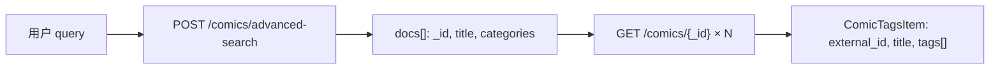

# 哔咔漫画（PicaComic）— 按标题/关键词搜索调研

> 调研日期：2026-09-01  
> Wayfinder ticket：[013-research-bika-title-search](../../.wayfinder/tickets/013-research-bika-title-search.md)  
> 关联文档：[bika-api-tags.md](./bika-api-tags.md)（认证、签名、列表字段总览）

---

## 0. 结论摘要

| 问题 | 结论 |
|---|---|
| 标题/关键词搜索用哪条 API？ | **`POST /comics/advanced-search?page={page}`**（社区现行首选） |
| 旧式 `GET /comics/search?q=` 还能用吗？ | 2019 年 Java 客户端仍封装，但**活跃 Python/Go/Kotlin 库均已迁移**至 advanced-search；新项目勿依赖 |
| `GET /comics?t=&a=` 能搜标题吗？ | **不能**。`t` 为 tag 精确筛选、`a` 为作者筛选，非全文搜索 |
| 列表含 `tags` 吗？ | **不含**；与分类浏览相同，需 `GET /comics/{id}` 二次拉详情 |
| 与现有 `BikaClient` 衔接 | 新增 `search_comics_page()` → `bika_ops` 封装 search→detail 流水线 |

---

## 1. 三条候选端点对比

### 1.0 速查对比

| 端点 | 方法 | 典型参数 | 标题/关键词搜索 | 分页 | 列表 `tags` | 本项目 |
|---|---|---|---|---|---|---|
| `/comics/advanced-search` | POST | `keyword`, `sort`, `categories[]` | ✅ **推荐** | `page` query + `docs/pages/total` | ❌ | **采用** |
| `/comics/search` | GET | `q`, `page` | ✅（遗留，功能被取代） | 同上 | ❌ | 不采用 |
| `/comics` | GET | `c`, `t`, `a`, `ct`, `ca`, `s`, `f`, `page` | ❌ 结构化筛选 | 同上 | ❌ | 仅 catalog（`c`+`s`） |

### 1.1 推荐：`POST /comics/advanced-search`

```
POST /comics/advanced-search?page={page}
Content-Type: application/json; charset=UTF-8

{
  "keyword": "关键词或标题片段",
  "sort": "dd",
  "categories": []
}
```

| 项 | 说明 |
|---|---|
| 用途 | App 内「搜索」功能的直接对应端点 |
| 采用方 | [pica_crawler search()](https://github.com/lx1169732264/pica_crawler/blob/master/src/client.py)、[pica-go SearchComics](https://github.com/niuhuan/pica-go/blob/master/client.go)、[picacomic-api ComicService.advancedSearch](https://github.com/czp3009/picacomic-api/blob/master/src/main/kotlin/com/hiczp/picacomic/api/service/comic/ComicService.kt)、[pica-rust advanced_search](https://github.com/niuhuan/pica-rust/blob/master/src/client.rs) |
| 优势 | 支持 `categories` 限定分区；`sort` 可选；与现行 Android 客户端行为一致 |
| 签名 path | `comics/advanced-search?page=1`（**含 query string**） |

**请求体字段**（[AdvancedSearchRequest.kt](https://github.com/czp3009/picacomic-api/blob/master/src/main/kotlin/com/hiczp/picacomic/api/service/comic/model/AdvancedSearchRequest.kt)）：

| 字段 | 类型 | 必需 | 说明 |
|---|---|---|---|
| `keyword` | `string` | ✅ | 搜索词（标题片段、作者名、tag 名等，服务端统一索引） |
| `sort` | `string` | 否，默认 `ua` | 排序，见 §2.3 |
| `categories` | `string[]` | 否，默认 `[]` | 分区名数组（如 `["同人"]`），空数组表示全站 |

### 1.2 遗留：`GET /comics/search`

```
GET /comics/search?page={page}&q={keyword}
```

| 项 | 说明 |
|---|---|
| 来源 | [PicaBookApi.search](https://github.com/2024baibai/PicaComic-Api/blob/master/src/com/flannep/picacomic/api/book/PicaBookApi.java)（2019） |
| 现状 | **无活跃维护库再封装**；功能上被 advanced-search 取代 |
| 响应 | 与 advanced-search 相同信封 `data.comics.{docs,page,pages,...}` |
| 建议 | 仅作兼容参考；**本项目实现 search 时不采用** |

### 1.3 不适用：`GET /comics`（带筛选参数）

```
GET /comics?page={page}&c={category}&t={tags}&a={author}&s={sort}&f={finished}&ct={chineseTeam}&ca={creatorId}
```

来源：[ComicService.search](https://github.com/czp3009/picacomic-api/blob/master/src/main/kotlin/com/hiczp/picacomic/api/service/comic/ComicService.kt)、[pica-go Comics()](https://github.com/niuhuan/pica-go/blob/master/client.go)

| 参数 | 含义 | 能否用于标题搜索 |
|---|---|---|
| `c` | 分类名（`Category.title`） | ❌ 分类浏览；**`c` 生效时其他筛选无效** |
| `t` | 标签 | ❌ tag **精确/筛选**（格式未公开文档化），非标题全文 |
| `a` | 作者 | ❌ 按作者名筛选，非标题 |
| `ct` | 汉化组 | ❌ |
| `ca` | 上传者 ID | ❌ |
| `s` | 排序 | — |
| `f` | 是否完结 | — |
| `page` | 页码 | — |

**结论**：`GET /comics` 是「分类/标签/作者/汉化组」**结构化筛选**，不是用户输入标题关键词的搜索入口。现有 `BikaClient.list_comics_page()` 已覆盖 `c` + `s` 场景（catalog 枚举），与 title search 无关。

---

## 2. 请求参数、分页、认证

### 2.1 认证与签名

与 [bika-api-tags.md §3](./bika-api-tags.md#3-认证登录authorization签名) 完全一致；`BikaClient` 已实现：

- 先 `POST /auth/sign-in` 取 `authorization` token
- 每次请求 HMAC-SHA256 签名（path 含 query）
- POST 必须带 `Content-Type: application/json; charset=UTF-8`
- 401 时 `BikaClient._request` 已自动重登重试

**advanced-search 签名示例**：

```
path = "comics/advanced-search?page=1"
raw  = path + timestamp + nonce + "POST" + api_key   # 全小写
```

### 2.2 分页模型

响应信封：

```json
{
  "code": 200,
  "message": "success",
  "data": {
    "comics": {
      "docs": [ /* ComicSimple[] */ ],
      "total": 42,
      "limit": 20,
      "page": 1,
      "pages": 3
    }
  }
}
```

| 字段 | 说明 |
|---|---|
| `page` | 当前页，**从 1 开始** |
| `pages` | 总页数；`page > pages` 时 `docs` 为空 |
| `limit` | 每页条数（通常 20，服务端决定） |
| `total` | 命中总数 |
| `docs` | 当前页本子列表 |

遍历模式（[pica_crawler search_all](https://github.com/lx1169732264/pica_crawler/blob/master/src/client.py)）：

```python
first = search(keyword, page=1)
for page in range(1, first["pages"] + 1):
    docs = search(keyword, page=page)["docs"]
```

### 2.3 排序值 `sort`

| 值 | 含义 | 来源 |
|---|---|---|
| `ua` | 默认（相关性/综合） | [pica-go enum.go](https://github.com/niuhuan/pica-go/blob/master/enum.go) |
| `dd` | 新→旧 | pica_crawler 订阅搜索默认 |
| `da` | 旧→新 | |
| `ld` | 最多爱心 | |
| `vd` | 最多浏览 | |

**标题搜索建议**：默认 `ua`（让服务端按相关性排序）；若用户明确要「最新上传」，用 `dd`。

---

## 3. 列表响应字段

列表项对应 `BookSimpleInfo` / `ComicSimple`（[README.MD](https://github.com/2024baibai/PicaComic-Api/blob/master/README.MD)、[pica-go dto.go](https://github.com/niuhuan/pica-go/blob/master/dto.go)）：

| 字段 | 类型 | 搜索列表 | 说明 |
|---|---|---|---|
| `_id` | `string` | ✅ | MongoDB ObjectId，即 `external_id` |
| `title` | `string` | ✅ | 标题（常含汉化组前缀如 `[xx汉化组]`） |
| `author` | `string` | ✅ | 作者 |
| `categories` | `string[]` | ✅ | 平台分区（同人/短篇等），**不是**自由 `tags` |
| `thumb` | `object` | ✅ | 封面 `{path, fileServer, originalName}` |
| `likesCount` | `number` | ✅ | 点赞数 |
| `finished` | `boolean` | ✅ | 是否完结 |
| `pagesCount` | `number` | ⚠️ 可能缺失 | advanced-search 注释称**有时不返回** |
| `epsCount` | `number` | ⚠️ 可能缺失 | 同上 |
| `updated_at` | ISO8601 | ⚠️ 有时有 | pica_crawler 订阅过滤用到 |
| `tags` | `string[]` | ❌ | **仅详情** `GET /comics/{id}` |

**不存在「部分 tags」**：列表阶段只有 `categories`（固定分区），自由标签 `tags[]` 必须打详情。

---

## 4. 匹配行为：完整标题 vs 关键词片段

> 哔咔未公开搜索算法文档；以下为社区逆向与客户端行为的**推断**，实施 `djm search` 时应按「候选列表 + 客户端消歧」设计，勿假设精确匹配。

### 4.1 推断的匹配规则

| 输入类型 | 预期行为 | 依据 |
|---|---|---|
| 关键词片段（如 `难言之隐`） | 返回标题/元数据中含该子串的本子 | [pica-go 示例](https://github.com/niuhuan/pica-go/blob/master/examples/examples.go) 用片段搜索 |
| 完整标题（含汉化组前缀） | 通常能命中，但**不保证排第一** | 标题常带 `[汉化组]` 前缀，用户输入往往不完整 |
| 多词/空格 | 行为未文档化；App 表现为**整串作为 keyword** 提交，是否 AND/OR 未知 | AdvancedSearchRequest 仅单 `keyword` 字段 |
| 作者名 | 可能一并命中（服务端索引范围未公开） | 移动端搜索框为通用搜索，非仅 title 字段 |
| Tag 名 | 可能命中（与 `GET /comics?t=` 不同，后者是筛选而非搜索） | 社区经验；未验证 |
| 精确唯一匹配 | **无** `exact=true` 类参数 | 各客户端均无此选项 |

### 4.2 完整标题 vs 片段的实践建议

1. **直接提交用户原始输入**为 `keyword`，取第 1 页 `sort=ua` 结果。
2. **客户端消歧**（供 ticket 015/017 参考）：
   - 若仅 1 条命中 → 直接取 `_id`
   - 若多条 → 按标题与 query 的归一化相似度排序（去空格、去 `[]` 汉化组前缀后比较）
   - 若 0 条 → 可尝试剥离汉化组前缀、缩短 query 后重试（可选启发式，非 API 能力）
3. **不要**用 `GET /comics?t=关键词` 代替搜索——那是 tag 筛选，漏掉大量标题匹配。

### 4.3 空结果与异常

| 场景 | 表现 |
|---|---|
| 无匹配 | `code=200`，`docs=[]`，`total=0` |
| 页码越界 | `docs=[]`（不报错） |
| 未登录 / token 过期 | `401`；`BikaClient` 已处理 |
| 签名/时间戳错误 | `400` + message |
| 限速 | 无公开 QPS；社区经验遇 `429` 或连接重置时指数退避（见 bika-api-tags §4.2） |

---

## 5. 与现有 `BikaClient` 的衔接

### 5.1 当前代码能力

[`src/doujinshi_meta/sources/bika.py`](../../src/doujinshi_meta/sources/bika.py) 已有：

| 方法 | 用途 |
|---|---|
| `login()` | 认证 |
| `get_comic(comic_id)` | 详情（含 `tags`） |
| `list_categories()` | 分类枚举 |
| `list_comics_page(category, page, sort)` | 分类浏览（catalog） |

[`bika_ops.py`](../../src/doujinshi_meta/sources/bika_ops.py) 已有 `fetch_comic_bika()` → `ComicTagsItem`，可直接复用于 search 之后的详情阶段。

### 5.2 建议新增（实现阶段，非本次调研交付）

**`BikaClient.search_comics_page`**：

```python
def search_comics_page(
    self,
    keyword: str,
    page: int = 1,
    *,
    sort: str = "ua",
    categories: list[str] | None = None,
) -> dict[str, Any]:
    if not self._token:
        self.login()
    path = f"comics/advanced-search?page={page}"
    body: dict[str, Any] = {"keyword": keyword, "sort": sort}
    if categories:
        body["categories"] = categories
    data = self._request("POST", path, json=body)
    if isinstance(data.get("comics"), dict):
        return data["comics"]
    return data
```

要点：

- 复用 `_request`（签名、401 重登、代理错误提示）
- 信封解包与 `list_comics_page` 对称（见 `test_list_comics_page_unwraps_comics_envelope`）
- POST 时 `_headers` 不自动加 `Content-Type`；调用前需像 `login()` 一样显式设置

**`bika_ops` 层**（供 `djm search`）：

```text
search_comics_bika(client, query, *, limit=20)
  → search_comics_page(query, page=1)["docs"][:limit]
  → 对每个 _id 调用 fetch_comic_bika(client, _id)
  → 返回 list[ComicTagsItem]
```

与现有 `fetch_tags()` 的关系：search 负责「query → ids」，detail 阶段复用同一 `fetch_comic_bika` + `DEFAULT_DELAY[Source.BIKA]`（1.5s）。

### 5.3 端到端数据流



---

## 6. 推荐调用路径（本项目）

### 6.1 标准流程

```
1. open_bika_client()          # 已有：凭证 + login + 代理
2. search_comics_page(query)   # 待实现：取候选 _id + title
3. fetch_comic_bika(id)        # 已有：拉 tags
4. 输出 FetchTagsResponse 或扩展的 search 响应
```

### 6.2 示例请求（curl 形态，仅供调试）

```http
POST https://picaapi.picacomic.com/comics/advanced-search?page=1
api-key: C69BAF41DA5ABD1FFEDC6D2FEA56B
accept: application/vnd.picacomic.com.v1+json
authorization: <token>
time: <unix_sec>
nonce: <32_hex>
signature: <hmac>
Content-Type: application/json; charset=UTF-8

{"keyword": "C101", "sort": "ua", "categories": []}
```

### 6.3 不做 / 低优先级

| 项 | 原因 |
|---|---|
| `GET /comics/search` | 遗留端点，无维护库跟进 |
| `GET /comics?t=` 当搜索 | 语义是 tag 筛选，非标题搜索 |
| `GET /keywords` | 热词推荐，非搜索 API |
| 列表阶段拿 tags | API 不提供，必须 N+1 详情 |

---

## 7. 参考链接

- [czp3009/picacomic-api — ComicService](https://github.com/czp3009/picacomic-api/blob/master/src/main/kotlin/com/hiczp/picacomic/api/service/comic/ComicService.kt)
- [lx1169732264/pica_crawler — search()](https://github.com/lx1169732264/pica_crawler/blob/master/src/client.py)
- [niuhuan/pica-go — SearchComics](https://github.com/niuhuan/pica-go/blob/master/client.go)
- [2024baibai/PicaComic-Api — PicaBookApi.search (legacy)](https://github.com/2024baibai/PicaComic-Api/blob/master/src/com/flannep/picacomic/api/book/PicaBookApi.java)
- [本项目 bika-api-tags.md](./bika-api-tags.md)
- [本项目 BikaClient](../../src/doujinshi_meta/sources/bika.py)
